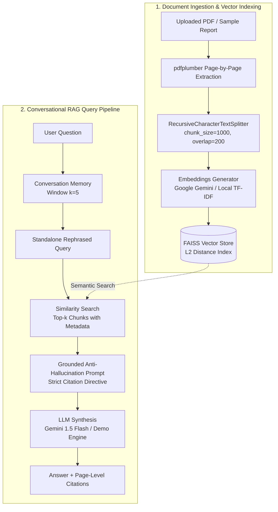

# 📄 PDF Chatbot using LangChain and RAG

[](https://python.org)
[](https://langchain.com)
[](https://aistudio.google.com/)
[](https://github.com/facebookresearch/faiss)
[](https://streamlit.io)
[](tests/)
[](app.py)
[](LICENSE)

A production-grade **Retrieval-Augmented Generation (RAG)** application allowing users to upload any PDF document, parse its contents, and query it using natural language. Built with **LangChain**, **Google Gemini API**, **FAISS**, and **Streamlit**, featuring multi-turn conversational memory, verifiable page-level source citations, and **zero-exposure secure key management**.

---

## 🏗️ Architecture



---

## 🛡️ Enterprise Security & Privacy (Zero Key Exposure)

- **No Key Leaks**: The application never echoes, logs, or prints your Google Gemini API key to the screen or console.
- **Environment & Secrets Integration**: Supports `.env` and `.streamlit/secrets.toml`. When an API key is detected in the environment, the UI displays a green secure badge (`🔒 API Key: Active & Protected (Hidden)`) without ever revealing the key string in the DOM.
- **Masked Password Fields**: Any manual key input uses strict HTML5 masked password fields.
- **Git Protection**: `.gitignore` strictly protects `.env`, `.streamlit/secrets.toml`, vector stores, and local cache from ever being committed to GitHub.

---

## ⚡ Instant Demonstration (Recruiter-Ready)

This repository includes everything needed to demonstrate the project end-to-end in seconds:

1. **Pre-packaged Sample Document**: Located at `sample_docs/Enterprise_AI_Report_2025.pdf` (a realistic 3-page industry analysis).
2. **1-Click Quick Demo Button**: Click **"📄 Quick Demo: Load Sample Report"** in the sidebar to index and chat immediately without uploading a file.
3. **Interactive Demo Mode (No API Key Required)**: An integrated offline demonstration pipeline (`LocalTFIDFEmbeddings` + `DemoExtractiveLLM`) that demonstrates semantic retrieval, multi-turn memory, and page citations with $0 cost and zero external dependencies.

---

## 📁 Repository Structure

```
pdf-rag-chatbot/
├── .streamlit/
│   └── config.toml           # Streamlit theme and server configuration
├── src/
│   ├── __init__.py
│   ├── document_processor.py # PDF text extraction and recursive text splitting
│   ├── vector_store.py       # FAISS vector store, Gemini & Local TF-IDF embeddings
│   └── rag_chain.py          # ConversationalRetrievalChain, memory & citations
├── tests/
│   ├── __init__.py
│   └── test_rag_pipeline.py  # 5 Pytest unit tests for chunking, indexing, and memory
├── sample_docs/
│   └── Enterprise_AI_Report_2025.pdf  # 3-page demo document
├── scripts/
│   └── generate_sample_pdf.py# Automated PDF generator script
├── app.py                    # Streamlit web application with modern chat UI
├── pytest.ini                # Pytest configuration
├── requirements.txt          # Production dependencies
├── .env.example              # Environment variables template
├── .gitignore                # Git ignore patterns
└── README.md                 # Project documentation
```

---

## 🚀 Quickstart Guide

### 1. Clone the Repository
```bash
git clone https://github.com/bhanushamdasani/pdf-rag-chatbot.git
cd pdf-rag-chatbot
```

### 2. Set Up a Virtual Environment
```bash
python -m venv venv
# On Windows:
venv\Scripts\activate
# On macOS / Linux:
source venv/bin/activate
```

### 3. Install Dependencies
```bash
pip install -r requirements.txt
```

### 4. (Optional) Configure Your Free Gemini API Key
To run in Live Mode with Google Gemini:
1. Get a free API key at [Google AI Studio](https://aistudio.google.com/app/apikey).
2. Copy `.env.example` to `.env`:
   ```bash
   cp .env.example .env
   ```
3. Set your key in `.env`:
   ```env
   GOOGLE_API_KEY=your_gemini_api_key_here
   ```
*(Note: If you don't have an API key, simply toggle **Offline Demo Mode** in the app to demonstrate the full pipeline.)*

### 5. Launch the Application
```bash
streamlit run app.py
```
Open your browser at `http://localhost:8501`.

---

## 🧪 Running Automated Tests

Run the test suite with `pytest`:

```bash
pytest
```

Expected output:
```
======================== 5 passed in 6.04s ========================
```

---

## 🌐 Deploy Free to Streamlit Community Cloud

Deploy with a live shareable URL for recruiters:

1. Push this repository to your GitHub account (`https://github.com/bhanushamdasani/pdf-rag-chatbot`).
2. Go to [share.streamlit.io](https://share.streamlit.io) and sign in with GitHub.
3. Select:
   - **Repository:** `bhanushamdasani/pdf-rag-chatbot`
   - **Branch:** `main`
   - **Main file path:** `app.py`
4. Under **Advanced Settings -> Secrets**, add:
   ```toml
   GOOGLE_API_KEY = "your_gemini_api_key"
   ```
5. Click **Deploy!** Your app will be live on the web with a public HTTPS link.

---

## 📋 Resume Summary

> **PDF Chatbot using LangChain and RAG | Python, LangChain, Google Gemini, FAISS, Streamlit | 2025**
> • Engineered a Retrieval-Augmented Generation (RAG) conversational pipeline allowing users to query uploaded PDFs with natural language, utilizing LangChain and Google Gemini 1.5 Flash.
> • Built an in-memory vector indexing pipeline using FAISS and Google Gemini embeddings with recursive character chunking; integrated conversational memory and page-level source citations across multi-turn interactions.
> • Implemented an automated unit test suite with `pytest` validating chunking logic, vector retrieval, and memory state; deployed on Streamlit Community Cloud with zero infrastructure cost and zero-exposure key security.

---

## 📄 License
This project is open-source and licensed under the [MIT License](LICENSE).
