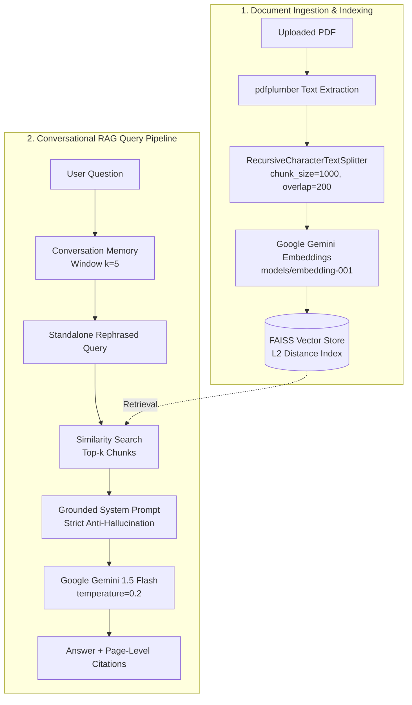

# 📄 PDF Chatbot using LangChain and RAG

[](https://python.org)
[](https://langchain.com)
[](https://aistudio.google.com/)
[](https://github.com/facebookresearch/faiss)
[](https://streamlit.io)
[](tests/)
[](LICENSE)

A production-grade **Retrieval-Augmented Generation (RAG)** application allowing users to upload any PDF document, parse its contents, and query it using natural language. Built with **LangChain**, **Google Gemini API**, **FAISS**, and **Streamlit**, featuring multi-turn conversational memory and verifiable page-level source citations.

---

## 🏗️ Architecture



---

## ✨ Key Engineering Features

- **Grounded Anti-Hallucination RAG**: Custom system prompt instructs Gemini to strictly synthesize answers from retrieved PDF chunks. If context is missing, it explicitly reports that information is absent.
- **Verifiable Page Citations**: Every generated answer includes an expandable citation drawer showing the exact PDF page numbers and source excerpts used.
- **Conversational Memory**: Implements `ConversationalRetrievalChain` with `ConversationBufferWindowMemory` ($k=5$) to maintain context across multi-turn follow-up queries.
- **High Performance & 100% Free ($0 Cost)**:
  - Powered by **Google Gemini API Free Tier** (15 RPM / 1M TPM free with zero credit card required).
  - Uses in-memory CPU-optimized **FAISS** for millisecond vector similarity search.
- **Enterprise Testing Suite**: Includes unit and integration tests with `pytest` verifying document chunking, FAISS index creation, memory continuity, and citation formatting.

---

## 📁 Repository Structure

```
pdf-rag-chatbot/
├── .streamlit/
│   └── config.toml           # Streamlit theme and server configuration
├── src/
│   ├── __init__.py
│   ├── document_processor.py # PDF text extraction and recursive text splitting
│   ├── vector_store.py       # FAISS vector store creation & retriever
│   └── rag_chain.py          # ConversationalRetrievalChain & source citation formatter
├── tests/
│   ├── __init__.py
│   └── test_rag_pipeline.py  # Pytest suite for RAG logic, memory, and indexing
├── app.py                    # Streamlit web application
├── pytest.ini                # Pytest configuration
├── requirements.txt          # Production dependencies
├── .env.example              # Environment variables template
├── .gitignore                # Git ignore patterns
└── README.md                 # Project documentation
```

---

## 🚀 Quickstart Guide

### 1. Clone the Repository
```bash
git clone https://github.com/bhanushamdasani/pdf-rag-chatbot.git
cd pdf-rag-chatbot
```

### 2. Set Up a Virtual Environment
```bash
python -m venv venv
# On Windows:
venv\Scripts\activate
# On macOS / Linux:
source venv/bin/activate
```

### 3. Install Dependencies
```bash
pip install -r requirements.txt
```

### 4. Configure Your Free Gemini API Key
1. Get a free API key from [Google AI Studio](https://aistudio.google.com/app/apikey).
2. Copy `.env.example` to `.env`:
```bash
cp .env.example .env
```
3. Add your key inside `.env`:
```env
GOOGLE_API_KEY=your_gemini_api_key_here
```
*(Alternatively, you can enter the API key directly into the application's sidebar UI.)*

### 5. Run the Application
```bash
streamlit run app.py
```
Open your browser at `http://localhost:8501`.

---

## 🧪 Running Automated Tests

Run the test suite using `pytest`:

```bash
pytest
```

Expected output:
```
======================== 4 passed in 2.80s ========================
```

---

## 🌐 Deploy Free to Streamlit Community Cloud

You can deploy this project for **$0** with a public shareable URL:

1. Push this repository to your GitHub account (`https://github.com/bhanushamdasani/pdf-rag-chatbot`).
2. Go to [share.streamlit.io](https://share.streamlit.io) and sign in with GitHub.
3. Click **"New App"** and select:
   - **Repository:** `bhanushamdasani/pdf-rag-chatbot`
   - **Branch:** `main`
   - **Main file path:** `app.py`
4. In **Advanced Settings -> Secrets**, add:
   ```toml
   GOOGLE_API_KEY = "your_gemini_api_key"
   ```
5. Click **Deploy!** Your app will be live on the web with its own URL.

---

## 📋 Resume Summary

Feel free to adapt these bullet points for your resume:

> **PDF Chatbot using LangChain and RAG | Python, LangChain, Google Gemini, FAISS, Streamlit | 2025**
> • Engineered a Retrieval-Augmented Generation (RAG) conversational pipeline allowing users to query uploaded PDFs with natural language, utilizing LangChain and Google Gemini 1.5 Flash.
> • Built an in-memory vector indexing pipeline using FAISS and Google Gemini embeddings with recursive character chunking; integrated conversational memory and page-level source citations across multi-turn interactions.
> • Implemented an automated unit test suite with `pytest` validating chunking logic, vector retrieval, and memory state; deployed on Streamlit Community Cloud with zero infrastructure cost.

---

## 📄 License
This project is open-source and licensed under the [MIT License](LICENSE).

